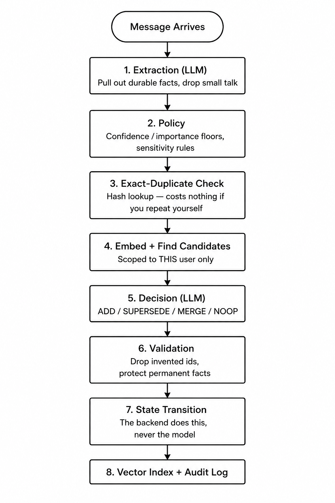

<div align="center">


# MemDream

**A self-maintaining long-term memory layer for AI agents.**

[](LICENSE)
[](https://www.python.org/downloads/)
[](tests/)
[](CONTRIBUTING.md)

[Quick start](#quick-start) · [How it works](#how-it-works) · [Use in your project](#use-it-in-your-project) · [Your own prompts](#write-your-own-prompts) · [Contributing](CONTRIBUTING.md)

</div>

---

## What is MemDream?

Most "agent memory" is a vector database with an `add()` call. That works right up
until the user contradicts themselves.

Tell it *"I live in Chennai"*, then later *"I moved to Bangalore"*, and a plain
vector store now holds **both**. It answers with whichever happens to be worded
closer to your question. Your agent confidently tells the user they live in the
wrong city.

MemDream is built around that problem. Every incoming fact is reasoned about
against what is already known, and one of four things happens:

| | When | What happens to the old memory |
|---|---|---|
| **ADD** | Genuinely new fact | — |
| **SUPERSEDE** | Contradicts something stored | Kept, marked `superseded`, points at its replacement |
| **MERGE** | Same fact, said better | Kept, marked `merged`, points at the canonical version |
| **NOOP** | Adds nothing | Nothing changes — and the reason is recorded |

Then, in the background, **Dream** reads across many memories and writes down the
patterns none of them state individually — with references back to its evidence.

**Nothing is ever deleted.** Superseded and merged memories are retained with
pointers to whatever replaced them, so *"where did they live before, and when did
that change?"* stays answerable forever.

---

## How it works

<div align="center">

</div>

When a message arrives, the cheap deterministic checks run first and the
expensive one runs last, on as little as possible:

```
your message
   ↓
extraction (LLM)          pull out durable facts, drop small talk
   ↓
policy                    confidence / importance floors, sensitivity rules
   ↓
exact-duplicate check     hash lookup — costs nothing if you repeat yourself
   ↓
embed + find candidates   scoped to THIS user only
   ↓
decision (LLM)            ADD / SUPERSEDE / MERGE / NOOP
   ↓
validation                drop invented ids, protect permanent facts
   ↓
state transition          the backend does this, never the model
   ↓
vector index + audit log
```

And separately, off the request path:

```
scheduler or API trigger
   ↓
candidate selection       1000 memories → ~200, deterministic
   ↓
clustering                → ~20 clusters
   ↓
synthesis (LLM)           one call per cluster
   ↓
idempotency check         source overlap, then semantic similarity
   ↓
pattern memory + provenance edges
```

### Design commitments

**Non-destructive.** No Dream operation deletes. Status transitions are one-way,
and terminal rows are never rewritten — which is also what makes a replayed
operation converge instead of corrupting the chain.

**LLM-assisted, not LLM-controlled.** The model returns a *proposal*. The backend
intersects its target ids with the ids it actually showed the model, clamps its
scores, and refuses to retire protected memories. A model cannot reach a memory
it was never given, so it cannot reach another tenant's memory by guessing an id.

**Tenant-safe by construction.** Every repository method takes a `MemoryScope`;
there is no method that reads a memory without one. The vector index is
partitioned physically per `(client, bot, user)`, so cross-tenant retrieval is
not something a filtering bug can cause — it is unrepresentable.

**Explainable.** Every operation writes an audit row, `NOOP` included. *"Why was
nothing remembered?"* is the question you will actually have, and it has an answer.

Diagrams: [`docs/diagrams.md`](docs/diagrams.md) · Full detail: [`docs/how-it-works.md`](docs/how-it-works.md) ·
[`docs/architecture.md`](docs/architecture.md)

---

## Quick start

### Option 1 — Docker (everything)

```bash
git clone https://github.com/your-org/memdream.git
cd memdream
cp .env.example .env        # fill in AZURE_OPENAI_*
docker compose up --build
```

Open http://localhost:8000/docs

### Option 2 — Run it locally

```bash
python -m venv .venv
.venv/Scripts/activate          # Windows
source .venv/bin/activate       # macOS / Linux

pip install -r requirements.txt          # or: pip install .
cp .env.example .env                     # fill in AZURE_OPENAI_*

uvicorn app.main:app --reload
```

For development, add the test and lint tooling:

```bash
pip install -r requirements-dev.txt      # or: pip install -e ".[dev]"
pytest
```

MemDream needs **MongoDB**. Redis and a second worker process are only needed for
background synthesis — see [one service or two](#one-service-or-two).

### Option 3 — Zero infrastructure

Every provider has an offline implementation, so you can see the whole thing work
with no database, no credentials and no network:

```bash
python examples/quickstart.py
```

### Try it

```bash
curl -X POST http://localhost:8000/v1/memories \
  -H 'Content-Type: application/json' \
  -d '{
        "prompt": "I live in Chennai and I work at Acme.",
        "phoneNumber": "+919999999999",
        "botId": "bot_123",
        "clientId": "client_456"
      }'

# now contradict it
curl -X POST http://localhost:8000/v1/memories \
  -H 'Content-Type: application/json' \
  -d '{
        "prompt": "I moved to Bangalore last month.",
        "phoneNumber": "+919999999999",
        "botId": "bot_123",
        "clientId": "client_456"
      }'

# → {"action":"SUPERSEDE","memoryId":"mem_...","supersededMemoryIds":["mem_..."]}
```

### The visual console

```bash
# with the API running
open console.html          # macOS
start console.html         # Windows
```

A single-file web console: multiple user sessions, live colour-coded decisions,
memory inspector, audit trail, token costs, and a log of every API call it makes.
The fastest way to understand what the system is doing.

---

## Use it in your project


```python
from memdream import DreamClient

client = DreamClient(
    base_url="http://localhost:8000",
    client_id="client_456",
    bot_id="bot_123",
    phone_number="+919999999999",   # set the scope once
)

# Remember
result = client.memory.add("I moved to Bangalore.")
print(result.action)                    # SUPERSEDE
print(result.superseded_memory_ids)     # ['mem_...']

# Recall
memories = client.memory.search("Where does the user live?", latest_only=True)
print(memories.as_context())
# - User lives in Bangalore.

# Dream
job = client.dream.synthesize()
job = client.dream.wait_for(job.job_id)
```

`AsyncDreamClient` has the same surface with awaitable methods.

### In an agent turn loop

Three lines, and it works with any framework:

```python
memories = client.memory.search(user_message, latest_only=True)   # recall
reply    = your_llm(system_prompt + memories.as_context(), user_message)
client.memory.add(user_message)                                   # remember
```

Two things worth copying: **recall before responding, remember after** (otherwise
the current message becomes context for answering itself), and **do the write in
the background** so the user is not waiting on it.

Working examples:

- [`examples/custom_agent.py`](examples/custom_agent.py) — any framework
- [`examples/semantic_kernel_agent.py`](examples/semantic_kernel_agent.py) — Semantic Kernel, as a plugin *and* a filter
- [`examples/quickstart.py`](examples/quickstart.py) — no infrastructure at all

### Manual control

The Dream layer decides what to keep from conversation. When you already know
exactly what to store, bypass it:

```python
client.memory.create("User is allergic to peanuts.", memory_type="constraint")
client.memory.update(memory_id, content="User has a severe peanut allergy.")
client.memory.forget(memory_id)                      # retire, reversible
client.memory.forget(memory_id, permanent=True)      # erase, irreversible
client.memory.purge(confirm=True)                    # erase everything for a user
```

### Or just HTTP

Every endpoint is documented at [`docs/api.md`](docs/api.md), and interactively at
`/docs` on a running instance.

---

## Write your own prompts

**This is the highest-leverage thing you can change.** All prompt text lives in
one file: [`app/dream/prompts.py`](app/dream/prompts.py).

```
_SUPERSEDE_RULES   (11 rules: never invent facts, additive detail ≠ contradiction…)
_MERGE_RULES       (10 rules: never lose information, don't merge different subjects…)
_SHARED_CLOSING    ("you recommend, you do not execute")
        │
        ├──► DECISION_SYSTEM      one call decides all four actions
        ├──► SUPERSEDE_SYSTEM     focused, for staged mode
        └──► MERGE_SYSTEM         focused, for staged mode

EXTRACTION_SYSTEM  what is worth remembering  ← tune this first
SYNTHESIS_SYSTEM   what patterns matter
```

Editing `_SUPERSEDE_RULES` updates the unified *and* focused prompts together, so
they cannot drift apart.

### Think of a prompt as three layers

| Layer | Example | Safe to change? |
|---|---|---|
| **Contract** | output JSON schema, "you propose, backend executes" | **No** — validation depends on it |
| **Safety** | never invent facts, preserve history, never lose information | **No** — these are your data-integrity guarantees |
| **Domain** | what matters in *your* vertical, what to ignore, examples | **Yes** — this is where to customise |

### Tuning for your use case

Start with `EXTRACTION_SYSTEM` — it decides what is worth remembering at all, and
that varies enormously between verticals. The same sentence means different
things to a healthcare intake bot, a recruiting bot and a shopping assistant.

```python
# app/dream/prompts.py
EXTRACTION_SYSTEM = """\
You extract durable long-term memories from a single user message.

## Domain
You are the memory for a healthcare intake assistant.

## Remember
symptoms, medications, allergies, appointment preferences, care providers

## Ignore
insurance claim numbers, payment details, small talk

## Examples
"I've been getting headaches every morning for two weeks"
  → [symptom] "User has experienced morning headaches for two weeks."
...
"""
```

**Worked examples move behaviour more than instructions do.** Two or three
input → output pairs are worth a paragraph of prose.

Then tune thresholds in [`config/dream.yaml`](config/dream.yaml) — but **measure
first**:

```bash
python -m scripts.calibrate
```

This embeds labelled pairs and reports where each relationship actually lands for
*your* model. Do not guess. Cosine similarity reads like a percentage and is not
one, and the bands move a lot between embedding models.

Everything is configurable without touching Python. Environment overrides YAML,
which overrides defaults:

```bash
DREAM_RETRIEVAL__TOP_K=20
DREAM_DREAM__SYNTHESIS__MIN_MEMORIES=50
DREAM_MEMORY__ALLOW_SENSITIVE=true
```

---

## One service or two?

**The queue is not on the user's path.** Remember, recall, supersede and merge all
run synchronously inside the API. Redis and the worker exist only for background
synthesis.

```bash
DREAM_QUEUE_PROVIDER=inline   # one process, no Redis
DREAM_QUEUE_PROVIDER=arq      # API + worker, survives restarts
```

| | `inline` | `arq` |
|---|---|---|
| Infrastructure | MongoDB only | MongoDB + Redis |
| Add / search / supersede | identical | identical |
| Synthesis runs | in the API process | on the worker |
| Survives a restart mid-synthesis | no | yes |
| Scheduled nightly sweep | no | yes |

Start with `inline`. Move to `arq` when you enable scheduled synthesis or scale
past one API replica.

```bash
# two-service mode
uvicorn app.main:app --reload
arq app.workers.synthesis_worker.WorkerSettings
```

---

## Providers

| Layer | Shipped | Interface |
|---|---|---|
| LLM | Azure OpenAI, offline fake | `app/providers/llm/base.py` |
| Embeddings | Azure OpenAI (`text-embedding-3-small`), offline fake | `app/providers/embeddings/base.py` |
| Vector store | FAISS (per-tenant partitions), in-memory | `app/providers/vector_store/base.py` |
| Queue | ARQ + Redis, inline | `app/providers/queue/base.py` |
| Canonical store | MongoDB | `app/repositories/` |

Nothing in `app/memory` or `app/dream` imports a concrete provider — they take the
base classes. Adding OpenAI, Ollama, Qdrant, pgvector or Celery is an adapter plus
one line in a factory, not a refactor.

---

## Testing and evaluation

```bash
pytest                 # 246 tests, fully offline, no credentials needed
python -m eval.run     # 250-case evaluation set
python -m eval.run --provider azure --report eval/results/azure.json
```

The evaluation set is 250 hand-written cases — 50 each of ADD, MERGE, SUPERSEDE,
NOOP and SYNTHESIS — including the cases that must *not* fire: additive detail
that looks like contradiction, two pets that look like duplicates, patterns
already covered by an existing pattern.

Offline baseline with the deterministic fake reasoner:

```
suite           cases  passed   overall    action
add                50      49    98.0%     98.0%
merge              50      43    86.0%     86.0%
supersede          50      39    78.0%     78.0%
noop               50      50   100.0%    100.0%
synthesis          50      30    60.0%     78.0%
TOTAL             250     211    84.4%
```

Run with `--provider azure` for the number that matters for your deployment.

---

## What it costs

Measured against `gpt-4o-mini` + `text-embedding-3-small`:

| Action | LLM calls | Approx. cost |
|---|---|---|
| Message with a new fact | 2 (extract + decide) | ~$0.0007 |
| Message, nothing related yet | 1 (extract only) | ~$0.0003 |
| **Exact repeat** | **0** — hash lookup | **$0** |
| **Search** | **0** | ~$0.0000001 |
| **Add / edit manually** | **0** | ~$0.0000001 |
| **Forget / erase** | **0** | **$0** |
| Run Dream | 1 per cluster | ~$0.0004 |

Input dominates by roughly 15:1, so if you want to reduce spend, shrink what you
send rather than what comes back. Live figures at `GET /v1/metrics/tokens`, broken
down by operation, and per-user at `GET /v1/dream/stats`.

---

## Documentation

| | |
|---|---|
| [`docs/diagrams.md`](docs/diagrams.md) | Architecture diagrams — start here |
| [`docs/how-it-works.md`](docs/how-it-works.md) | Technical walkthrough with code references |
| [`docs/architecture.md`](docs/architecture.md) | Why each decision went the way it did |
| [`docs/api.md`](docs/api.md) | Endpoint reference |
| [`config/dream.yaml`](config/dream.yaml) | Every tunable, annotated |
| [`examples/`](examples/) | Runnable integrations |
| [`CONTRIBUTING.md`](CONTRIBUTING.md) | How to contribute |

---

## Status

Alpha. The interfaces are settled; the tuning is not.

- **FAISS is in-process.** The index is a file shared between API and worker via a
  volume, with an inter-process lock and atomic replace. Correct for a handful of
  processes on shared storage, not for horizontal scale-out. Beyond that,
  implement `VectorStore` against a vector *server*. MongoDB holds every
  embedding, so `scripts/rebuild_index.py` regenerates the index at any time.
- **Extraction quality dominates everything downstream.** A fact extracted
  ambiguously will be consolidated ambiguously.
- **Sensitivity is a single flag.** `allow_sensitive` covers credentials, health,
  financial and address data together, so you cannot currently keep allergies
  while refusing API keys. Per-category policy is planned.

---

## Contributing

Contributions are very welcome — see [`CONTRIBUTING.md`](CONTRIBUTING.md).

Good first issues: a new provider adapter (OpenAI, Ollama, Qdrant, pgvector),
extraction prompts for a new vertical, or evaluation cases that expose a failure
mode we do not handle.

---

## License

[Apache License 2.0](LICENSE) — free for commercial and private use, with an
explicit patent grant.
