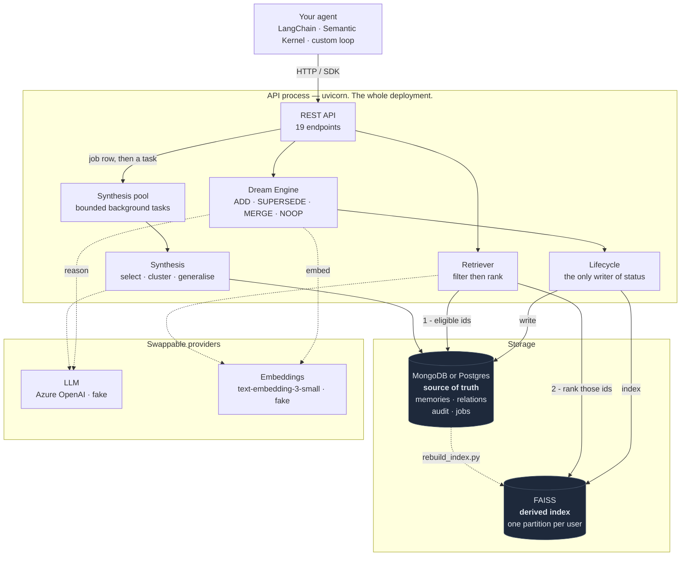
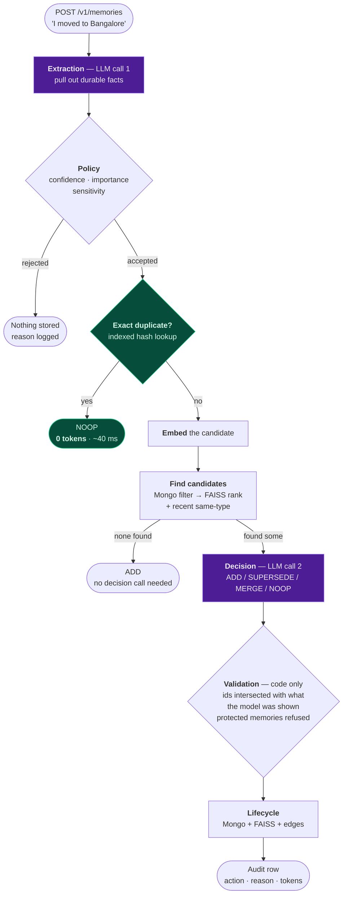
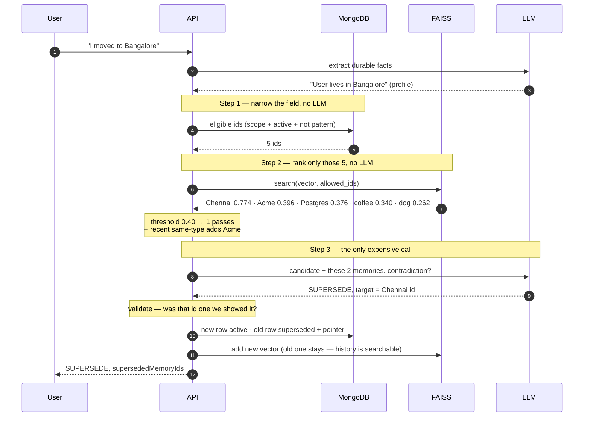
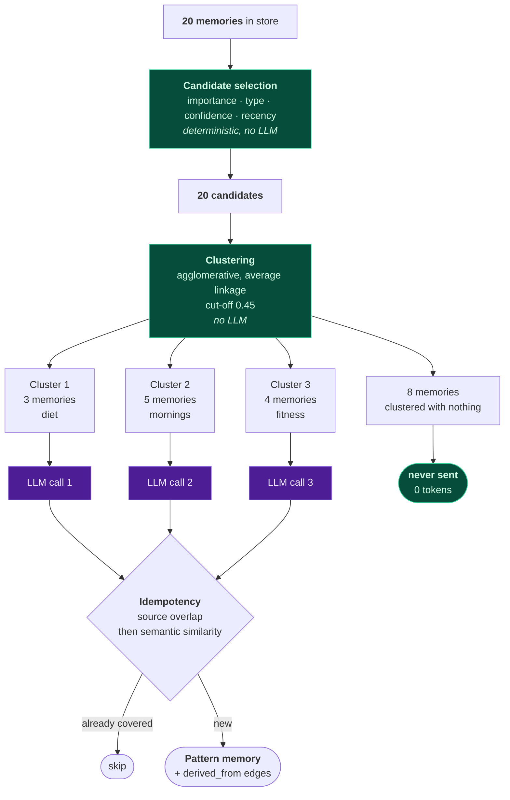
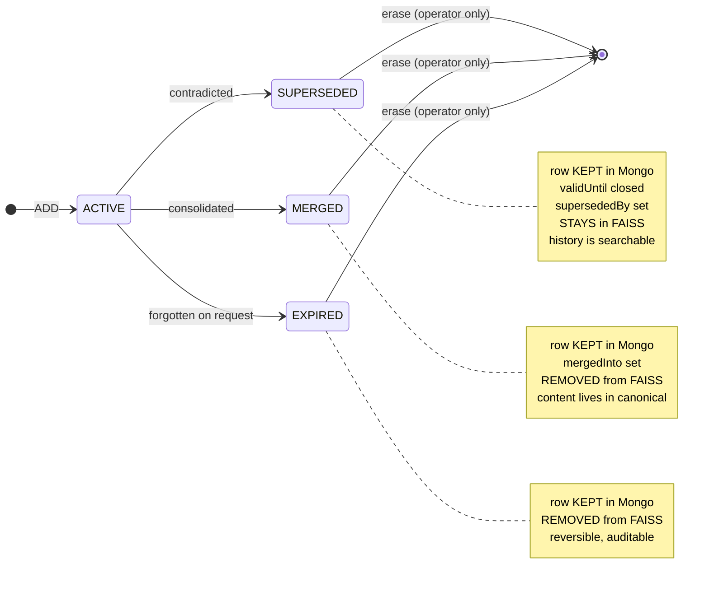

# Diagrams

Five views of MemDream, each answering one question. GitHub renders these
natively; paste any block into [mermaid.live](https://mermaid.live) to edit.

---

## 1. System architecture

*What are the moving parts?*

**Two key points.**

The database holds every embedding, so FAISS is disposable — delete it and
rebuild.

There is no second process and no broker. Synthesis is detached from the request
that triggered it by a bounded pool of tasks in the same process, which is all
"background" has to mean when the work is idempotent and its trigger is a
durable fact rather than an event. Set `DREAM_QUEUE_PROVIDER=database` to move
it to a worker instead — for several API replicas sharing one queue.

---

## 2. The write path

*What happens when a user says something?*

**The cheap deterministic checks run first.** An exact repeat returns `NOOP`
having spent no embedding and no LLM call.

---

## 3. How it finds the contradiction

*The Chennai → Bangalore case, with real measured numbers.*

**Why 0.774:** a contradiction is *lexically almost identical* to what it
contradicts. "User lives in Chennai" and "User lives in Bangalore" differ by one
token. That is exactly what makes it findable.

---

## 4. Synthesis — the funnel

*With 20 memories, what actually reaches the model?*

**Cost scales with clusters, not memories.** A user with 1,000 memories does not
cost 50× a user with 20 — the deterministic funnel caps what reaches the model.

---

## 5. Memory lifecycle

*Nothing is ever deleted by a Dream operation.*

Terminal states have no outgoing transitions. History is immutable — which is
also what makes a replayed operation converge instead of corrupting the chain.

| Status | In Mongo | In FAISS |
|---|---|---|
| `active` | yes | yes |
| `superseded` | yes | **yes** — history is searchable |
| `merged` | yes | no — content is in the canonical memory |
| `expired` | yes | no |
| erased | no | no |
